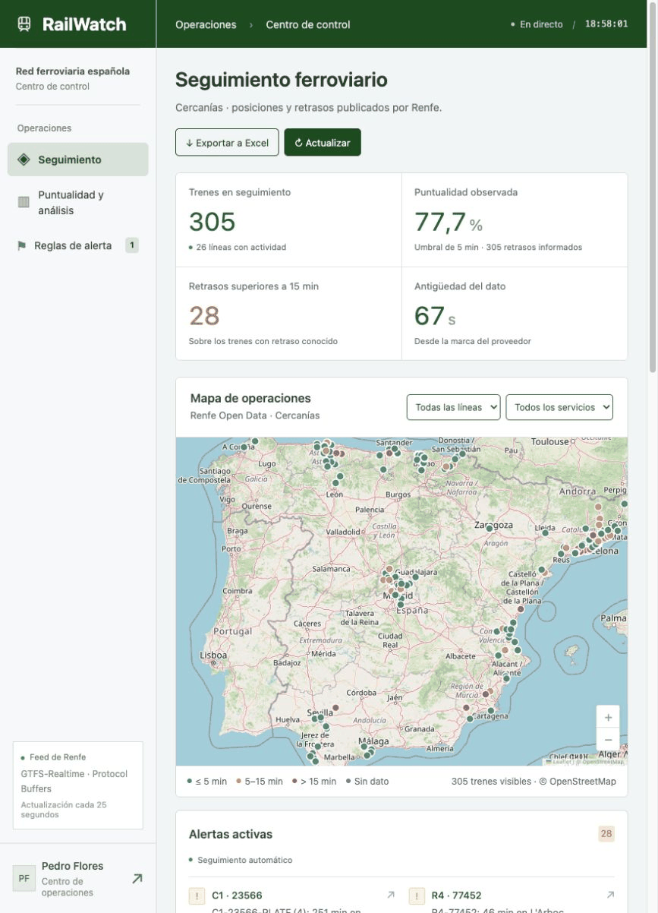
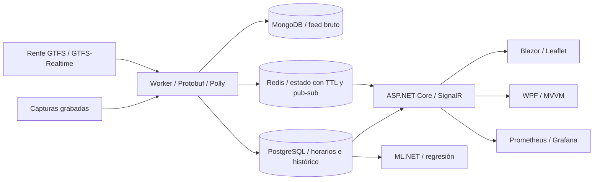

# RailWatch

[](https://github.com/PedroFlores199/RailWatch/actions/workflows/ci.yml)

**Centro de control ferroviario con posiciones reales de Renfe, mapa web y cliente de escritorio Windows.** Un worker cruza GTFS-Realtime con horarios, calcula retrasos cuando hay datos suficientes y distribuye cambios por SignalR.



| En 60 segundos | Qué puedes comprobar |
| --- | --- |
| Seguir | Mapa de España, filtros de línea y trenes con colores según retraso. |
| Consultar | Estaciones, próximas llegadas informadas e histórico por tren. |
| Alertar | Reglas persistentes por línea, estación y umbral; sonido en WPF. |
| Analizar | Puntualidad por línea, estación, hora y día; SQL con ventanas y percentiles. |
| Recuperar | Si falla Renfe, reproducción explícita de capturas públicas incluidas. |
| Exportar | Excel desde la web y desde la aplicación de escritorio. |

**Stack:** C# 12 · .NET 10 LTS · Worker Service · PostgreSQL/EF Core/Dapper · MongoDB · Redis · SignalR · Blazor Server · Leaflet · WPF/MVVM · ML.NET.

## Probarlo

```bash
git clone https://github.com/PedroFlores199/RailWatch.git
cd RailWatch
docker compose up --build -d
```

Abre [localhost:5090](http://localhost:5090). Arranca en **reproducción de capturas reales** para ofrecer un recorrido estable: alrededor de 300 trenes, varias líneas y retrasos registrados. La banda superior indica la fecha original. No se presentan como circulación actual.

Para consultar el feed actual:

```bash
FEED_MODE=Live docker compose up -d --force-recreate worker
```

En Live se descarga el horario completo al iniciar y cada 24 horas. El feed público configurado cubre **Cercanías y Rodalies**, no una cobertura garantizada de AVE o Media Distancia. El filtro de tipo admite esas categorías si se conecta otro proveedor; con el proveedor actual puede no devolver resultados. Una posición sin retraso informado mantiene `null`, no se contabiliza como puntual.

Sin Docker: SDK .NET 10 y `./scripts/run-local.sh`. Utiliza SQLite y el mismo reproductor; PostgreSQL, MongoDB, Redis y Dapper se prueban en el despliegue completo.

## Aplicación Windows

Descarga el ZIP para tu arquitectura en [Releases](https://github.com/PedroFlores199/RailWatch/releases), descomprímelo y ejecuta `RailWatch.Desktop.Wpf.exe`. Requiere Windows 10/11 y la API accesible en `http://localhost:5090`. Para otro servidor, establece `RAILWATCH_URL` antes de abrirlo.

El cliente implementa MVVM con CommunityToolkit, inyección de dependencias, reconexión SignalR, filtros, alertas visuales/sonoras, barras de puntualidad por línea y exportación a Excel. El ViewModel se prueba en macOS/Linux; GitHub Actions abre la ventana real en Windows y guarda una captura. Los paquetes MSIX de Releases están **sin firmar**: el ZIP es la descarga ejecutable directamente. La firma de un instalador distribuible requiere un certificado del publicador.

## Arquitectura



| Carpeta | Responsabilidad |
| --- | --- |
| `src/RailWatch.Shared` | Contratos, cálculo de retrasos y ViewModel comprobable sin Windows. |
| `src/RailWatch.Infrastructure` | GTFS, Protobuf, repositorios, métricas, analítica y regresión. |
| `src/RailWatch.Worker` | Ingesta periódica, respaldo, registro bruto y publicación. |
| `src/RailWatch.Api` | REST, SignalR, salud, Excel y alojamiento web. |
| `src/RailWatch.Web.Blazor` | Centro de control interactivo. |
| `src/RailWatch.Desktop.Wpf` | Interfaz de escritorio e integración Windows. |
| `samples` | Capturas públicas y un subconjunto del horario para reproducirlas. |

**Por qué tres bases:** PostgreSQL conserva relaciones e histórico; MongoDB permite auditar/reprocesar los bytes originales; Redis sirve el estado actual con caducidad y comunica procesos. La réplica de Redis no sustituye al histórico. EF Core escribe y mantiene el modelo; Dapper expresa directamente percentiles y funciones de ventana. El histórico de Live y Replay se consulta por separado.

## Pruebas y mediciones

20 pruebas automáticas: retrasos explícitos y desconocidos, límites de alertas, horas GTFS superiores a 24, horario de Madrid, ViewModel, alertas repetidas, lectura de capturas Protobuf, API, Excel y agregaciones contra PostgreSQL real con Testcontainers.

```bash
dotnet test
RUN_CONTAINER_TESTS=1 dotnet test
```

GitHub Actions verifica Linux y Windows y construye las imágenes. El job de Windows abre WPF conectado a la API de reproducción, comprueba que recibe trenes, renderiza su ventana y genera ZIP/MSIX para x64 y ARM64.

En 100.000 observaciones sintéticas, 30 repeticiones de la misma agregación dieron **15,58 ms de mediana en EF Core y 14,88 ms en Dapper**. Los resultados se compararon automáticamente; la diferencia es pequeña y no justifica atribuir toda la elección a velocidad. Dapper se usa aquí por el control sobre el SQL analítico. [Resultados y condiciones](docs/benchmark-results.json). Repetir: `BENCHMARK_POSTGRES` con base vacía y `dotnet run -c Release --project tools/RailWatch.Benchmarks`.

[API en Swagger](http://localhost:5090/swagger) · Hub `/hubs/trains` · Salud `/health/live`, `/health/ready` · Métricas `/metrics` · [Decisiones](docs/architecture.md) · [Entrevista](docs/interview.md) · [Validación](docs/validation.md) · [Informe de puntualidad de la muestra](docs/punctuality-report.md).

## Predicción y observabilidad

La regresión de ML.NET estima el retraso en la siguiente estación a partir del retraso actual, línea y hora. Requiere 200 pares válidos de estaciones consecutivas y divide los datos por tiempo 80/20, publicando el error absoluto medio. Las tres capturas incluidas no garantizan esa cantidad: la interfaz muestra **Sin modelo** hasta que el histórico permita entrenar. La predicción no sustituye el dato del proveedor. El modelo permanece en memoria y debe entrenarse tras reiniciar.

`docker compose --profile observability up -d` añade [Prometheus](http://localhost:9090) y [Grafana](http://localhost:3000), con paneles provisionados de trenes procesados/minuto, latencia y errores de feed.

## Datos y alcance

Fuente: [ubicación de vehículos](https://data.renfe.com/dataset/ubicacion-vehiculos), [horarios](https://data.renfe.com/dataset/horarios-cercanias) y [GTFS-Realtime](https://gtfs.org/documentation/realtime/reference/). Atribución: **Renfe**, datos públicos bajo **CC BY 4.0**. Las capturas se incluyen para reproducibilidad, no como afirmación de retrasos actuales. [Procedencia de las muestras](samples/README.md).

Demostración local con puertos restringidos a `127.0.0.1`, configuración de alertas sin cuentas de usuario y esquema creado con `EnsureCreated`. Un despliegue público requiere autenticación, migraciones y secretos propios. El mapa base usa OpenStreetMap y necesita conexión; las capturas de trenes funcionan sin Renfe. El indicador de puntualidad cuenta observaciones con retraso conocido, no viajes completados.

La interfaz utiliza la misma paleta verde y blanca y fuente de sistema que TechDocs, siguiendo la referencia visual de [Paperless-ngx](https://docs.paperless-ngx.com/). Los paneles de observabilidad opcionales se alojan en Grafana. [Licencias y atribuciones](NOTICE.md).
