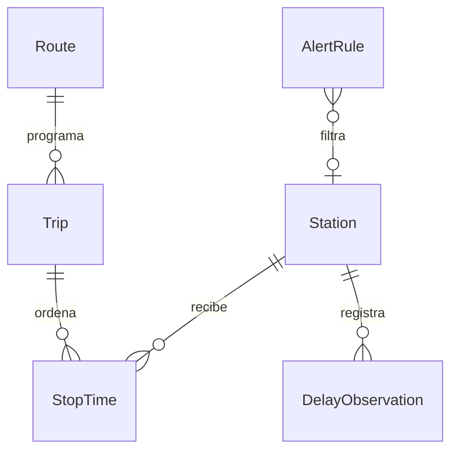

# Arquitectura y datos

El importador lee CSV de un ZIP GTFS respetando campos entrecomillados y horas superiores a 24. Reemplaza el horario en una transacción. El histórico no depende de claves foráneas hacia ese horario para que una actualización de catálogo no borre observaciones anteriores.

El worker consulta Protobuf cada 25 segundos. Prioriza un retraso explícito del feed; si no existe, solo calcula la diferencia cuando dispone de hora real y hora planificada con fecha de servicio. El resultado desconocido es `null`. Los viajes cancelados no se presentan como trenes en circulación.

MongoDB conserva posiciones y actualizaciones en bytes junto a su fecha y modo, con TTL de siete días. PostgreSQL registra observaciones idempotentes por tren, instante y modo. Redis guarda cada tren durante 90 segundos y el snapshot durante 120; la API recibe pub/sub y SignalR distribuye el snapshot. Un cliente recién conectado recibe el estado disponible antes de las siguientes actualizaciones.

Los reintentos y circuit breaker provienen de `Microsoft.Extensions.Http.Resilience` (Polly). Un fallo activa Replay y la UI cambia su etiqueta. La antigüedad del proveedor también se señala en Live. Los tres frames incluidos se repiten de forma determinista; no se inventan trayectorias entre estaciones.

Las estadísticas usan Dapper sobre PostgreSQL. Incluyen percentil 95 y funciones `LAG`/`ROW_NUMBER` para comparar observaciones consecutivas. Las consultas locales alternativas utilizan EF Core. El benchmark compara una agregación equivalente, no una consulta de EF deliberadamente menos eficiente.

ML.NET usa regresión SDCA y codificación de línea. Se forman pares consecutivos con cambio de estación y menos de 45 minutos de separación; se exigen 200 pares y se reserva el 20% final para evaluar. El modo de la fuente se filtra antes de entrenar. La muestra incluida no permite asegurar un modelo útil; por eso las predicciones permanecen ausentes cuando faltan datos.

El modelo se aplica en el receptor de la API al proyectar cada snapshot, por lo que también funciona con worker y API en procesos distintos. La prueba de predicción comprueba el paso desde un productor sin modelo a un receptor entrenado.
